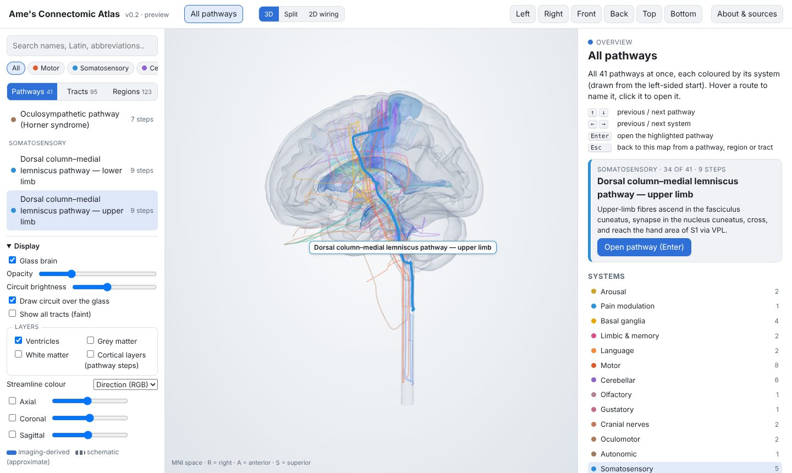
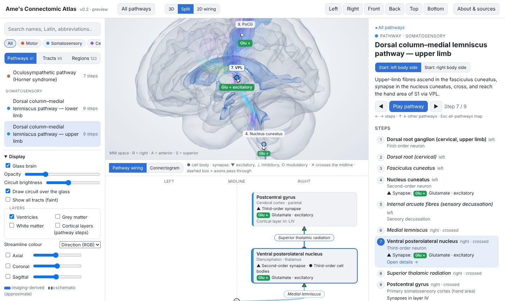

# Ame's Connectomic Atlas

An interactive 3D atlas of how the human nervous system is wired, for neuroanatomy students at
medical-school level and above.

**[Open the atlas →](https://abynetio.github.io/Ame-s-Connectomic-Atlas/)** It runs in the
browser, with nothing to install, and works on phones.

Slice atlases show where structures are. This atlas shows how they connect: which neurons project
where, through which tract, where they synapse and cross the midline, and what they release.

## What you can do

- **See every pathway at once.** The start page draws all 41 pathways in a glass brain, coloured
  by system. Hover over a route to name it, or click it to open it.
- **Trace a pathway step by step**, from either side. Each neuron's cell bodies and synapses are
  marked, along with every decussation, and each pathway has a lesion-localisation table.
- **See what each synapse does.** Every neuron has its transmitter and its effect (excitatory,
  inhibitory or modulatory). Cortical steps also give the layers where neurons start and end.
- **Switch to 2D.** You can show a left/right wiring diagram of the pathway, or a connectogram of
  every projection. Both are linked to the 3D view.
- **Look up any region or tract.** Each has its English and Latin names, abbreviations, what it
  projects to and receives from, clinical notes, and references.
- **Get your bearings.** The glass brain, ventricles, grey and white matter, cortical layer
  columns and MRI slices can each be switched on or off.

### Keyboard

| On the map | In a pathway |
|---|---|
| <kbd>↑</kbd> <kbd>↓</kbd> previous / next pathway | <kbd>←</kbd> <kbd>→</kbd> previous / next step |
| <kbd>←</kbd> <kbd>→</kbd> previous / next system | <kbd>↑</kbd> <kbd>↓</kbd> previous / next pathway |
| <kbd>Enter</kbd> open the highlighted pathway | <kbd>Esc</kbd> back to the map |

Every view has its own link, e.g. `…/#pathway=dcml_upper_limb&step=7&view=split`.

## What's covered

41 pathways, 123 regions, 95 tracts and 86 region-to-region projections, with 34 references.

Pathways by system

- **Motor:** lateral corticospinal (hand, leg), anterior corticospinal, corticobulbar (face,
  tongue), lateral vestibulospinal, pontine reticulospinal, tectospinal
- **Cerebellar:** cortico-ponto-cerebellar, dentato-rubro-thalamic, dorsal and ventral
  spinocerebellar, cuneocerebellar, Guillain–Mollaret triangle
- **Somatosensory:** dorsal column–medial lemniscus (upper, lower limb), anterolateral, trigeminal
  touch, trigeminal pain
- **Visual and eye movements:** retino-geniculo-calcarine, pupillary light reflex, horizontal VOR,
  horizontal saccade, trochlear
- **Other senses:** auditory, olfactory, gustatory
- **Cranial-nerve reflexes:** corneal (blink), gag
- **Autonomic:** oculosympathetic (Horner syndrome)
- **Basal ganglia:** direct, indirect, hyperdirect, nigrostriatal
- **Limbic:** Papez circuit, mesolimbic
- **Language:** dorsal and ventral streams
- **Arousal and pain modulation:** dorsal and ventral ascending arousal routes, descending pain
  modulation (PAG → RVM → dorsal horn)

## Please read

- **Not for clinical use.** This is a teaching aid. Don't use it for diagnosis or surgical
  planning. Diffusion tractography shows the course of fibre bundles, not synapses or direction,
  and it has false positives and negatives.
- **Some shapes are drawn by hand.** Most structures come from open MRI atlases. Where none exists
  (spinal cord, small brainstem nuclei, dentate nucleus), they are hand-drawn **schematic** shapes
  (wireframes and dashed lines). Their positions are approximate.
- **How the content was made.** The wiring, pathway steps, transmitters, cortical layers and
  clinical notes were compiled with AI assistance (Claude, Anthropic) from the cited textbooks and
  papers. Every entry is referenced, but **no neuroanatomist has reviewed it yet**. Check it against
  your course materials. If you find a mistake, please
  [open an issue](https://github.com/Abynetio/Ame-s-Connectomic-Atlas/issues) and include a source.

## Data and licences

- **Code:** MIT ([LICENSE](LICENSE)).
- **Atlas content and derived data:** [CC BY-SA 4.0](LICENSE-DATA.md).
- **HCP-derived data:** the tractography and CIT168 labels also come under the
  [WU-Minn HCP Open Access Data Use Terms](DATA_USE_TERMS.md).

The 3D geometry comes from open atlases in MNI ICBM152 space:
- HCP1065 and HCP842 tractography (Yeh et al.)
- the ICBM152 2009 template and CerebrA (McGill)
- THOMAS thalamic nuclei
- CIT168 subcortical nuclei
- ATAG basal ganglia
- the Harvard Ascending Arousal Network atlas

Licences and citations for each are in [ATTRIBUTION.md](ATTRIBUTION.md). Textbooks and papers are
cited for facts only; no text or figures are copied from them.

> Data were provided [in part] by the Human Connectome Project, WU-Minn Consortium (Principal
> Investigators: David Van Essen and Kamil Ugurbil; 1U54MH091657) funded by the 16 NIH Institutes
> and Centers that support the NIH Blueprint for Neuroscience Research; and by the McDonnell Center
> for Systems Neuroscience at Washington University.

## Contributing and running it yourself

Corrections and new pathways are welcome. The content is plain YAML with citations, and a
validator checks every change. [CONTRIBUTING.md](CONTRIBUTING.md) explains how to build the atlas
locally, how the repository is organised and how to add content. The original design notes and
data-source survey are in [docs/PLAN.md](docs/PLAN.md).
